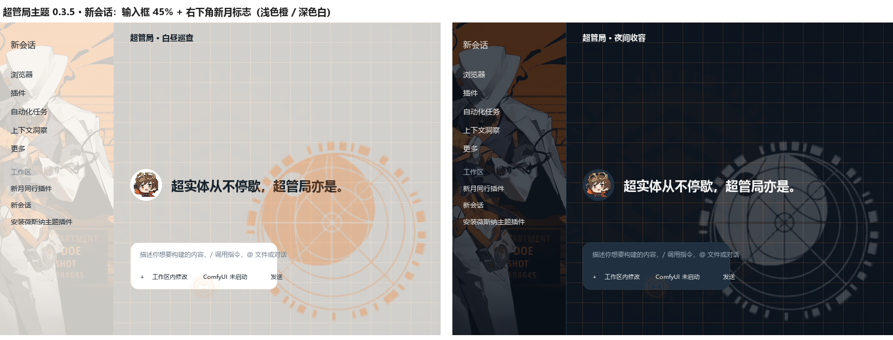
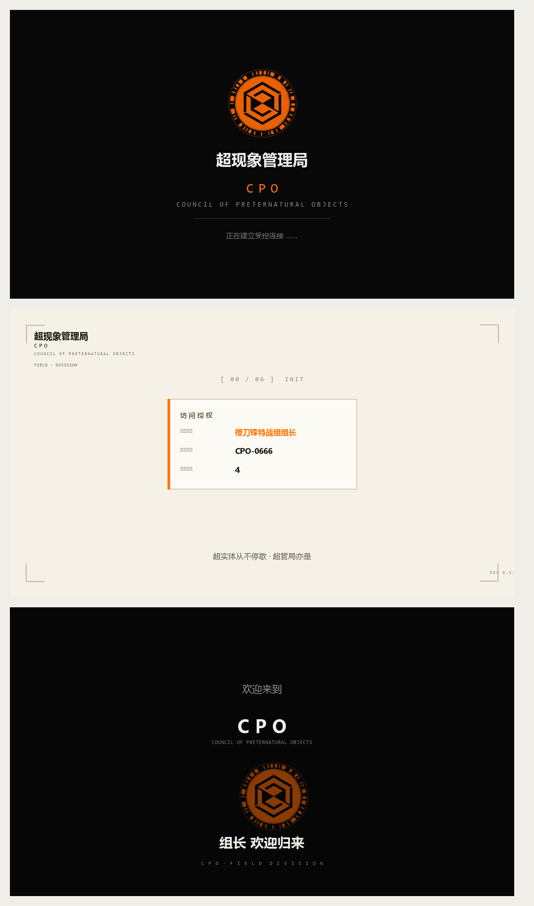
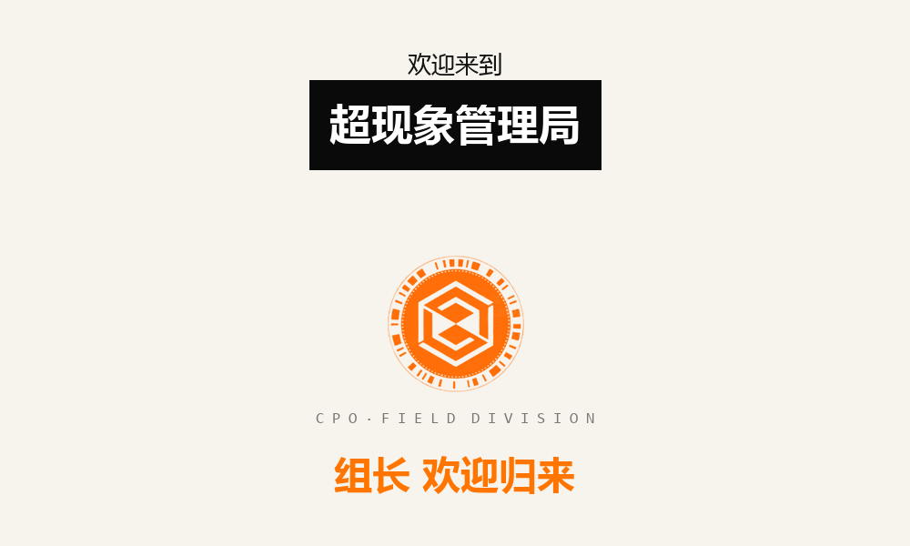

# 超管局主题（dsh-fellowmoon-theme）

以《新月同行》超现象管理局（超管局）为灵感的 DSH 桌面主题。颜色语言取自设定：

- **橙 = 一线 / 中坚**：外勤特工的橙色风衣，也是品牌主色与强调色。
- **黑 = 精锐**：特战小组成员黑衣配橙银点缀，深色外观的底色。
- **白 = 中层领导**：特战组长与分局长的白制服，浅色外观的底色。
- **深蓝 = 高层**：月球总局的冷色调，用于文字与侧栏。

## 预览

## 功能

- 两套配色：**白昼巡查**（浅色）、**夜间收容**（深色），可选跟随系统。
- **全窗口里世界场景**：暗色网格与徽标底纹，明暗两种遮罩下都能读。
- **侧栏个人背景**：左侧会话栏铺一张淡化的人像图，蒙一层底色保证文字清晰。
- **聊天框底部超管局徽标**：淡化的橙色徽标水印，作为发信框的底纹。
- **特工头像**：新会话按钮、主页欢迎区与发送按钮改用头像（功能文字保留）。
- 聊天消息两种材质：**液态折射**（液态玻璃）与 **磨砂遮蔽**（高斯模糊）。
- 设置页「部门配色」：橙风衣、白制服、深蓝高层、警示红、银金。
- **CPO 开机动画**：启动时走一遍六幕授权序列（黑幕厂牌 → 过曝洗白 → 技术档案底板 → 五步授权 → 色散故障揭幕 → 机位后撤），徽标、身份卡（橙刀锋特战组组长 / CPO-0666 / 权限 4）与终幕「组长 欢迎归来」均为超管局版本；Esc 或「跳过」可退出。

## 安装

1. 到 [Releases](https://github.com/aeonsscope/dsh-fellowmoon-theme/releases) 下载 `dsh-fellowmoon-theme-0.4.0.tgz`。
2. 打开应用的「插件 → 添加插件」，选择刚下载的 tgz。
3. 安装后到「设置 → 通用设置 → 超管局主题」选择配色与装饰。
4. 开机动画随插件自动生效；想临时关掉，删掉 `~/.dsh/cpo-startup.json` 里的 `enabled` 或改成 `false`（该文件不存在时按默认值播放）。

> 本机 Desktop 版本请通过应用内插件管理页面安装，不要用旧版全局 CLI 修改 Desktop 配置。

## 开机动画怎么改

- 运行时：`lib/startup/splash.js`（五步序列、台词、身份卡）与 `lib/startup/splash.css`（黑白底板与排版）。
- 文案与身份：`lib/index.js` 的 `DEFAULTS`（`identity` / `identityId` / `accessLevel` / `brand1..3b` / `orgZh` / `orgEn` / `orgSub` / `welcomeBox` / `footer` / `welcomeLine`）。
- 徽标：替换 `lib/startup/assets/startup-emblem.webp`（建议 512×512 透明底）。
- 声音：`lib/startup/assets/line-1..6.mp3` 与 `sfx-tick*.mp3`。

## 自己改主题

- 配色：改 `src/palette.js` 的 `PALETTES`（17 色 → 约 57 个 `--dsw-alias-*`）。
- 文案：改 `src/client.js` 的 `dictionaries`，以及 `src/art.js` 的 `installHeroCopy` 句子。
- 素材：替换 `assets/wallpaper.webp`、`assets/emblem.webp`、`assets/sidebar.webp`、`assets/sticker-0..5.webp`、`assets/stickers.webp`。
- 构建：`node scripts/build.mjs`，会重新拼出 `lib/client.js`。

## 许可与来源

派生自 [dsh-vesna-theme](https://github.com/Mahiru0427/dsh-vesna-theme)（MIT），开机动画的序列与音效派生自 [dsh-startup-screen](https://github.com/6shenhonghong9/dsh-startup-screen)（MIT © 沈宏宏），均沿用其 MIT 许可。

> **美术素材声明**：`assets/` 与 `docs/screenshots/` 中的图像取自《新月同行》官方美术，版权归其各自权利人所有，此处仅作个人、非商业的主题演示用途，不在 MIT 许可覆盖范围内。如需商用请自行替换为自有素材。
